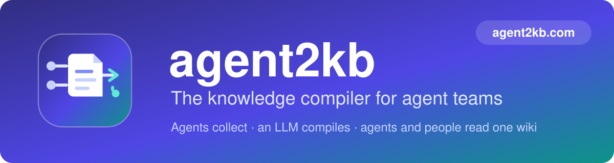
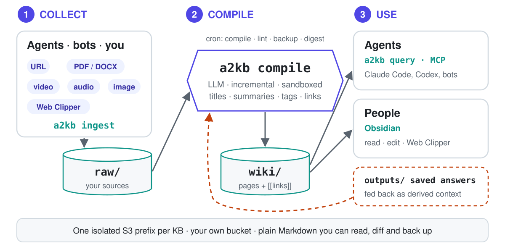
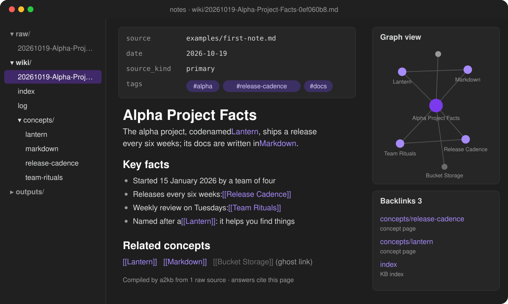
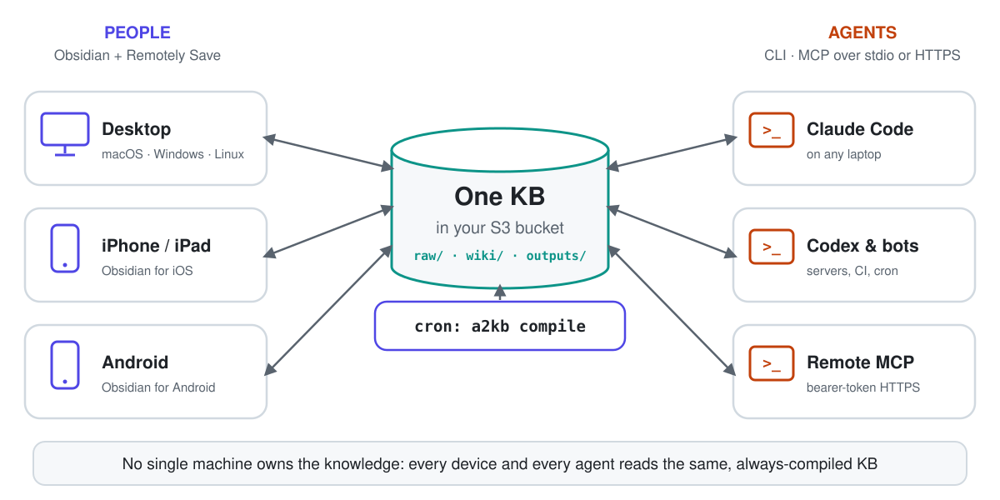
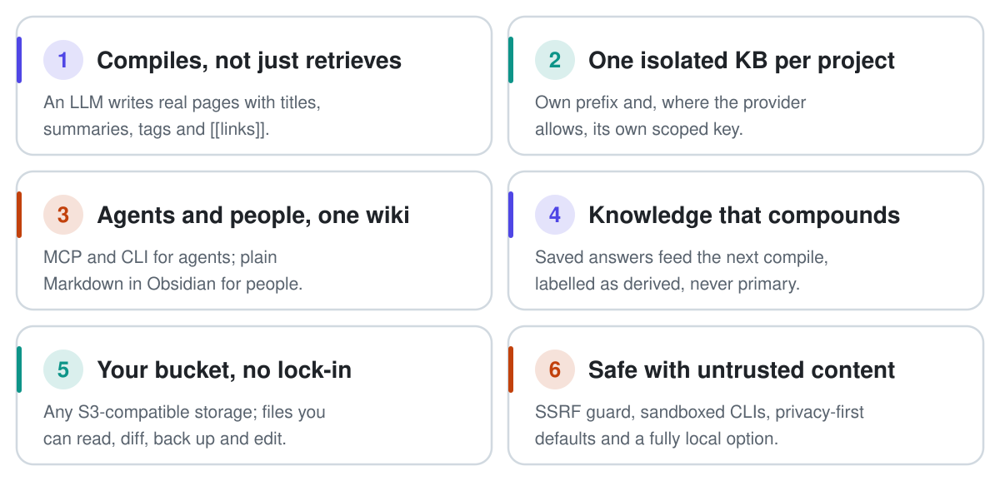

<p align="center">
  <a href="https://agent2kb.com"></a>
</p>

<p align="center">
  <b>agent2kb는 에이전트가 찾아낸 모든 것을 살아 있는, 출처가 명시된 Markdown 위키로 바꿉니다.</b><br>
  LLM이 여러분의 버킷 안에서 위키를 컴파일하고, 에이전트는 MCP로,
  사람은 Obsidian이나 다른 Markdown 편집기로 읽습니다.
</p>

<p align="center">
  <a href="https://agent2kb.com"><b>agent2kb.com</b></a> ·
  <a href="#사용해-보기">사용해 보기</a> ·
  <a href="docs/first-run.md">첫 실행</a> ·
  <a href="#agent2kb를-쓰는-이유">agent2kb를 쓰는 이유</a> ·
  <a href="#문서">문서</a>
</p>

<p align="center">
  <a href="https://github.com/jcaol/agent2kb/actions/workflows/ci.yml"></a>
  <a href="LICENSE"></a>
  <a href="pyproject.toml"></a>
  
  
  
</p>
<p align="center">
  <a href="README.md">English</a> · <a href="README.ja.md">日本語</a> ·
  <a href="README.de.md">Deutsch</a> · <a href="README.es.md">Español</a> ·
  <a href="README.pt-BR.md">Português (Brasil)</a> · <a href="README.fr.md">Français</a> ·
  <b>한국어</b> · <a href="README.zh-TW.md">繁體中文</a>
</p>

<p align="center"><i>이 문서는 번역본입니다. 기준 문서는 <a href="README.md">영어 README</a>이며, 영어판이 더 최신일 수 있습니다.</i></p>
<!-- Switch on once the package is on PyPI:
[](https://pypi.org/project/agent2kb/)
-->

**에이전트 팀을 위한 헤드리스(headless) 지식 컴파일러입니다.** 에이전트와 봇이 원본 소스(웹
페이지, 동영상, PDF, 노트)를 제출하면 LLM이 이를 서로 링크된 Markdown 페이지로 이루어진,
스스로 유지되는 위키로 컴파일합니다. 에이전트는 CLI나 MCP로 위키를 읽고, 사람은 Obsidian이나
다른 Markdown 편집기로 읽습니다. 각 프로젝트는 S3 호환 버킷 안에 서로 격리된 자체 위키를 가지며,
어떤 애플리케이션도 계속 켜 둘 필요가 없습니다.

<picture>
  <source media="(prefers-color-scheme: dark)" srcset="docs/assets/pipeline-dark.svg">
  
</picture>

<!-- TODO(demo): record a short terminal GIF (ingest -> compile -> query) and save it as
     docs/assets/demo.gif, then uncomment:

-->

- **한 번 수집하면 컴파일은 무인으로 진행됩니다.** cron이 compile, lint, backup, digest를
  실행하며, 어떤 LLM을 사용할 수 없으면 파이프라인이 다른 LLM으로 전환(fallback)합니다.
  에이전트에게 필요한 것은 `a2kb ingest`뿐입니다.
- **프로젝트마다 하나의 지식 베이스(KB).** 각 KB는 자체 prefix를 가지며, 스토리지 제공자가
  허용하는 경우 자체 자격 증명도 가집니다. 따라서 한 KB에서 작업하는 에이전트는 다른 KB에
  접근할 수 없습니다.
- **에이전트와 사람이 함께 쓰는 하나의 위키.** 에이전트는 MCP 서버나 CLI를 사용하고, 사람은
  `[[wikilinks]]`가 포함된 일반 Markdown을 Obsidian이나 다른 Markdown 편집기로 읽습니다.
  저장된 답변이 다음 컴파일에 반영되므로, 위키는 가장 자주 질문받는 영역에서 성장합니다.
- **신뢰할 수 없는 콘텐츠와 개인정보 보호를 고려한 설계.** 웹 페이지와 파일 다운로드는 SSRF
  가드를 거치고(`yt-dlp`가 직접 가져오는 동영상 URL은 문서화된 예외입니다), `claude`와
  `codex`는 도구 없이 실행되며, 새 KB는 클라우드 부가 경로를 비활성화한 상태로 시작하고,
  Ollama를 사용한 완전 로컬 구성도 지원합니다.

Andrej Karpathy의
[LLM 위키 패턴](https://gist.github.com/karpathy/442a6bf555914893e9891c11519de94f)을 따르며,
이를 서버 측 도구로 구현했습니다.

### 위키 편집기에서 팀이 보는 화면

<p align="center">
  
</p>

컴파일된 모든 페이지는 속성(`source`, `date`, 태그, `source_kind`), 요약, 구조화된 섹션,
`[[wikilinks]]`를 갖춘 일반 Markdown으로 도착합니다. 따라서 Obsidian의 그래프 뷰, 백링크, 태그
검색이 별도 설정 없이 동작하며, `index.md`는 그 주에 KB가 새로 알게 된 내용을 정리한
"Past 7 days" 요약으로 시작합니다. 아직 해결되지 않은 링크는 이후 컴파일이나 `a2kb stubs`가
채울 때까지 고스트 노드로 남습니다. *이 일러스트는
[examples/first-note.md](examples/first-note.md)의 샘플로 만들었습니다. vault를 연결하는 방법은
[docs/obsidian.md](docs/obsidian.md)를 참고하십시오.*

Obsidian은 agent2kb가 문서화하고 권장하는 리더입니다. `[[wikilinks]]`, 그래프, 백링크를
렌더링하고 Remotely Save 플러그인으로 S3에서 동기화할 수 있기 때문입니다. 파일은 일반
Markdown이므로 이를 읽을 수 있는 편집기라면 무엇이든 사용할 수 있습니다. 다만 Obsidian 이외의
도구는 S3에서 동기화하는 방법을 별도로 마련해야 하며, 테스트되지 않았습니다.

### 자동으로 작성되는 새 소식 요약

컴파일할 때마다 `wiki/index.md`의 맨 위가 최근 7일간의 요약으로 갱신됩니다. 새 페이지들의 공통
주제를 LLM이 해당 페이지를 바탕으로 짧게 정리한 요약과, 각 페이지로 가는 링크로 구성됩니다.
누구도 직접 작성할 필요가 없고 KB와 함께 최신 상태로 유지되므로, 휴가에서 돌아온 팀원이나
일주일에 한 번 확인하는 학습자도 KB가 새로 알게 된 내용을 한눈에 볼 수 있습니다. 예시(가상의
내용)는 다음과 같습니다.

```markdown
## Past 7 Days (4 articles)

> This week the KB focused on safer releases. Two articles compare canary and blue-green
> deployments and agree that automated rollback matters more than the strategy itself; a
> third shows how feature flags keep unfinished work out of a release, and an incident review
> traces an outage to a missing health check, linking it to [[Rollback]] and [[Monitoring]].

- 2026-10-20 [[20261020-Canary-Releases-in-Practice-1a2b3c4d|Canary Releases in Practice]]
- 2026-10-19 [[20261019-Blue-Green-Deployments-5e6f7a8b|Blue-Green Deployments]]
- 2026-10-17 [[20261017-Feature-Flags-for-Safe-Releases-9c0d1e2f|Feature Flags for Safe Releases]]
- 2026-10-15 [[20261015-Incident-Review-Missing-Health-Check-3a4b5c6d|Incident Review: Missing Health Check]]
```

기간은 설정으로 바꿀 수 있습니다(`recent_days`: 월간 요약은 `30`, 끄려면 `0`). 또한 선택 사항인
주간 digest가 더 긴 요약을 `outputs/weekly/`에 작성합니다.

### 모든 기기와 모든 에이전트가 하나의 KB로

<picture>
  <source media="(prefers-color-scheme: dark)" srcset="docs/assets/devices-dark.svg">
  
</picture>

KB는 한 대의 컴퓨터가 아니라 여러분의 S3 버킷에 있으므로, 동일한 컴파일된 위키가 모든 기기에
전달됩니다. macOS, Windows, Linux의 Obsidian, iPhone과 iPad, Android(Remotely Save 플러그인
사용)는 물론, 모든 노트북, 서버, CI runner의 에이전트(CLI 또는 MCP 사용)도 마찬가지입니다.
compile은 스토리지 옆에서 일정에 따라 실행되므로, 모든 기기가 꺼져 있는 동안에도 페이지는 계속
개선됩니다. 휴대폰에는 HTTPS 엔드포인트가 필요합니다(AWS S3, Cloudflare R2, 또는 HTTPS
프로필을 사용한 Docker 백엔드). [docs/obsidian.md](docs/obsidian.md)를 참고하십시오. 메인테이너는
이전 버전에서 자체 호스팅한 SeaweedFS 백엔드를 대상으로 여러 데스크톱 및 모바일 기기의 Obsidian과
함께 이 구성을 운영해 왔습니다. 현재 릴리스의 레시피는 아직 처음부터 끝까지 다시 실행해 보지
않았습니다.

## 사용해 보기

아래 사전 요구 사항이 갖춰지면 첫 페이지까지 몇 분이면 됩니다. 클라우드 계정, 버킷, 키를 만드는
데는 더 오래 걸리며, 그 방법은 [스토리지 제공자](docs/storage-providers.md)에 설명되어 있습니다.

사전 요구 사항: POSIX 셸이 있는 Linux 또는 macOS(패키지가 선언한 플랫폼이며, Windows는 테스트되지
않았습니다), `venv` 모듈이 포함된 Python 3.10 이상(Debian과 Ubuntu에서는
`sudo apt install python3-venv`), 그리고 `git`. 그다음 다음이 필요합니다.

- **스토리지:** S3 호환 버킷과 그 키(AWS S3 및 Cloudflare R2 레시피:
  [스토리지 제공자](docs/storage-providers.md)), 또는 스토리지가 포함된
  [Docker 백엔드](#10분-만에-docker-백엔드-구성하기).
- **LLM:** 설치되어 로그인된 `claude` 또는 `codex` CLI
  (`npm i -g @anthropic-ai/claude-code` 후 `claude auth login`, 또는 `npm i -g @openai/codex`
  후 `codex login`), 또는 API 키(Gemini, Groq, OpenRouter), 또는 로컬 Ollama 서버.

### 설치

agent2kb와 그 의존성이 시스템 Python과 분리되도록 가상 환경에 설치하십시오(많은 Linux
배포판은 시스템 전역 `pip install`을 `externally-managed-environment` 오류로 거부합니다).

```bash
git clone https://github.com/jcaol/agent2kb.git && cd agent2kb
python3 -m venv .venv                       # 최초 1회: .venv/에 격리된 환경 생성
source .venv/bin/activate                   # 새 터미널마다 실행 (zsh, bash)
python -m pip install --upgrade pip
python -m pip install ".[all]"              # 첫 PyPI 릴리스 전까지는 소스에서 설치
a2kb --help                                 # 명령 목록이 출력되어야 함
```

`python -m pip`는 `PATH`에서 어떤 `pip`가 먼저 나오든 활성화된 환경에 설치합니다. 이후 새
터미널에서는 `a2kb`를 사용하기 전에 체크아웃 디렉터리에서 `source .venv/bin/activate`를 다시
실행하거나, `.venv/bin/a2kb`를 직접 호출하십시오(예: cron에서). `deactivate`로 환경에서 나갈 수
있습니다.

`[all]`은 모든 제공자 SDK, 문서 및 동영상 수집, MCP 서버를 설치합니다. `claude` 또는 `codex`
CLI 로그인으로 텍스트, Markdown, 웹 페이지만 다룬다면 더 작은 설치로 충분합니다.

```bash
python -m pip install .                     # 코어만 (확인됨: 설치되고 `a2kb --help`가 실행됨)
python -m pip install ".[mcp]"              # 코어와 에이전트용 MCP 서버
```

코어 설치 외에 각 기능에 추가로 필요한 것(`a2kb doctor`가 빠진 항목을 알려 줍니다):

| 기능 | Python extra | 외부 프로그램 |
|---|---|---|
| Markdown, 텍스트, 웹 페이지 | 없음 | 없음 |
| LLM으로 `claude` / `codex` CLI 사용 | 없음 | 로그인된 해당 CLI |
| Gemini, Groq, OpenRouter, Ollama | `gemini`, `groq`, `openai`, `ollama` | Ollama의 경우 Ollama 서버 |
| 임베딩과 rerank(선택 사항) | `voyage`, `openai`, `gemini` 또는 `ollama`; 더 빠른 벡터 검색에는 `fast` | 없음 |
| `.docx`, `.xlsx` 문서 | `media` | 없음 |
| PDF | `media` | 없음 |
| 기타 문서 형식(예: `.epub`) | 없음 | `pandoc` |
| 동영상 URL(YouTube 등) | `media` (yt-dlp) | `ffmpeg` |
| 로컬 오디오 및 동영상 전사 | `whisper` (무거움; `all`에 **포함되지 않음**) | `ffmpeg` |
| MCP 서버(`a2kb mcp`) | `mcp` | 없음 |

extra는 조합할 수 있습니다: `python -m pip install ".[mcp,media]"`. Python 패키지는 `ffmpeg`나
`pandoc`을 설치하지 않으므로 시스템 패키지 관리자를 사용하십시오(`apt install ffmpeg pandoc`,
`brew install ffmpeg pandoc`).

### 첫 KB

```bash
a2kb setup                        # 마법사: 스토리지, LLM, 언어, 개인정보 보호, 첫 KB (notes)
a2kb doctor                       # 설정, S3 접근, LLM 로그인, 외부 도구 점검

a2kb ingest --file examples/first-note.md       # 저장소에 포함된 작은 샘플
a2kb compile                      # raw/ -> wiki/ (증분; --force는 전체를 다시 컴파일)
a2kb query "What is the codename of the alpha project?"
```

[첫 실행 튜토리얼](docs/first-run.md)은 같은 단계를 각 단계의 예상 출력(raw 파일 이름, 위키
페이지, 출처가 명시된 답변)과 함께 안내하고, Obsidian을 연결하며, 흔한 문제에 대한 복구 표를
제공합니다. 자신의 소스를 수집하려면 `a2kb ingest --url <url>`, `--file <path>` 또는
`--folder <dir>`를 사용하십시오.

KB가 아직 없는 상태에서 아무 명령이나 실행하면, `a2kb`가 `a2kb setup`을 시작하도록 제안합니다
(터미널에서만 해당하며, 스크립트, cron, 에이전트는 평소와 같은 오류를 받습니다).

`a2kb doctor`는 `claude` 또는 `codex` 로그인이 없으면 실패로 보고합니다. 로그인하기 전까지는
정상적인 동작이며, API 키와 Ollama는 로그인이 필요 없습니다. KB가 정확히 하나뿐이면 `-p`
옵션을 생략할 수 있고, KB가 여러 개라면 `a2kb -p notes ...`를 사용하십시오. `a2kb list`는
KB 목록을 보여 주며, `a2kb new myproject --here`는 `.kb/config.yaml` 포인터를 작성하여 프로젝트
폴더에서 `-p` 없이 `a2kb`를 사용할 수 있게 합니다. 패키지 이름은 `agent2kb`이며, 설치되는 유일한
명령은 `a2kb`입니다(더 짧게 쓰려면 `alias kb=a2kb`를 사용할 수 있습니다).

## agent2kb를 쓰는 이유

에이전트 팀의 지식은 채팅 로그, 임시 메모, 브라우저 탭에 쌓입니다. 이를 모두 벡터 스토어에
넣으면 이해가 아닌 조각이 돌아오고, 하나의 공유 vault는 프로젝트가 뒤섞이며 일관성을 유지하는
프로세스가 없습니다. 그리고 어느 방식도 그 지식에 의존하는 사람들이 이를 검증할 방법을 제공하지
않습니다.

agent2kb는 작업을 세 단계로 나눕니다. **수집**은 의도적으로 단순합니다. 어떤 프로세스든
`ingest`를 실행해 소스를 `raw/`에 넣을 수 있습니다. **이해**는 컴파일 단계입니다. LLM이 소스를
제목, 요약, 태그, 링크를 갖춘 페이지로 바꾸고, 변경된 부분만 다시 작성하며, 스스로 도출한
내용에 라벨을 붙여 원본 소스와 충돌할 때 원본이 우선하도록 합니다. **활용**은 같은 파일 위의 두
가지 인터페이스로 이루어집니다. 에이전트용 `a2kb query`와 MCP, 그리고 사람을 위한 Obsidian입니다.
모든 것이 여러분의 버킷에 Markdown으로 저장되므로, 직접 읽고, 비교하고, 백업하고, 수정할 수
있습니다.

<picture>
  <source media="(prefers-color-scheme: dark)" srcset="docs/assets/pillars-dark.svg">
  
</picture>

### 비교표

| | 벡터 스토어 / RAG | 공유 노트 vault | 에이전트 세션 메모리 | **agent2kb** |
|---|:---:|:---:|:---:|:---:|
| 조각이 아닌 읽을 수 있는 페이지 | ❌ 청크 | ✅ 수작업 작성 | ❌ 대화 기록 | ✅ **LLM이 컴파일** |
| 수작업 없이 일관성 유지 | ❌ | ❌ | ❌ | ✅ **증분 compile + lint** |
| 프로젝트별로 분리·격리된 지식 | ⚠️ 인덱스별 | ❌ 하나의 vault | ⚠️ 에이전트별 | ✅ **KB마다 prefix와 키 하나씩** |
| 에이전트와 사람이 같은 소스를 사용 | ❌ 에이전트만 | ⚠️ 사람만 | ❌ 에이전트만 | ✅ **MCP + Markdown 편집기** |
| 모든 답변에 출처 명시 | ⚠️ | ❌ | ❌ | ✅ |
| 직접 소유한 스토리지의 일반 파일 | ❌ | ✅ | ❌ | ✅ **모든 S3 버킷** |
| 제3자 없이 실행 가능 | ⚠️ | ✅ | ❌ | ✅ **Ollama + 로컬 S3** |

모든 파일에는 YAML frontmatter(`title`, `source`, `date`, `tags`, `source_kind`)가 있습니다.
`source_kind`는 신뢰도를 기록합니다. 원본 소스와 큐레이션된 주제는 1차 자료이고, 개념 페이지와
저장된 답변은 파생 자료입니다. [docs/compounding-loop.md](docs/compounding-loop.md)를
참고하십시오.

## 기능

| | |
|---|---|
| **수집(Ingest)** | URL, YouTube 및 기타 동영상, 오디오, PDF/DOCX/XLSX, 이미지(OCR), Markdown, Obsidian Web Clipper 클리핑; 중복 감지, 가져오기 전 안전성 검사 |
| **컴파일(Compile)** | `[[wikilinks]]`, 개념 페이지, 고스트 링크 stub을 포함한 raw-to-wiki 증분 컴파일; "Past 7 days" 요약으로 시작하는 인덱스와 선택 사항인 주간 digest; 영어 또는 지정한 어떤 언어로든 출력 |
| **질의(Query)** | 선택적 임베딩 및 reranking을 지원하는 키워드 검색, 출처가 명시된 답변, 검색어 확장; `outputs/`에 저장된 답변이 누적 루프(compounding loop)를 완성 |
| **에이전트 접근** | MCP 서버(`a2kb mcp`, stdio 또는 bearer 토큰으로 보호되는 HTTP), 기본값은 읽기 전용; `ask`와 `ingest_url`은 opt-in |
| **격리** | 클라이언트가 강제하는 KB별 prefix; 제공자가 범위를 제한할 수 있는 경우 KB별 자격 증명 |
| **LLM** | `claude` / `codex` CLI 로그인(샌드박스 적용, fallback CLI 지원), Gemini, Groq, OpenRouter, Ollama; 대량 컴파일과 보조(aux) 작업에 별도 모델 사용 |
| **운영** | `a2kb doctor`, `lint`, `backup` 및 `restore`, 컴파일마다 실행 요약, `scripts/`의 cron 래퍼 |
| **Docker 백엔드** | `docker compose up` 한 번으로: KB별 키를 갖춘 SeaweedFS, cron, KB마다 MCP 서버, 선택적 HTTPS |

## 빠른 시작 (로컬)

[사용해 보기](#사용해-보기)에서 전체 과정을 다루며, [첫 실행 튜토리얼](docs/first-run.md)에서
각 단계의 예상 결과를 확인할 수 있습니다. 추가 참고 사항은 다음과 같습니다.

- `a2kb setup --non-interactive`는 CI와 프로비저닝을 위해 모든 값을 플래그와 `KB_*` 변수에서
  받습니다([플래그](docs/configuration.md#non-interactive-setup)).
- 스토리지 프리셋: AWS S3, Cloudflare R2, Backblaze B2, MinIO, SeaweedFS, Wasabi, 기타
  ([스토리지 제공자](docs/storage-providers.md)).
- compile, lint, backup, stubs는 일정에 따라 실행됩니다.
  [위키를 컴파일된 상태로 유지하기](#위키를-컴파일된-상태로-유지하기)를 참고하십시오.
- 모든 명령과 플래그: [docs/commands.md](docs/commands.md).

## 위키를 컴파일된 상태로 유지하기

`a2kb ingest`는 소스를 `raw/`에 저장할 뿐이며, 페이지는 `a2kb compile`이 실행될 때 생성됩니다.
직접 실행할 수도 있지만 일반적인 구성에서는 **일정에 따라** 실행하므로, 에이전트나 사람이 수집한
모든 것이 누군가 기다릴 필요 없이 페이지가 됩니다.

| agent2kb 실행 방식 | compile 일정을 잡는 주체 |
|---|---|
| Docker 백엔드 | 자동으로 처리됨: 15분마다 compile, 매일 lint, 하루 두 번 backup, 매일 stubs (`KB_CRON_DIGEST=1`로 주간 digest 추가) |
| 네이티브 설치(Linux, macOS) | `scripts/`의 래퍼를 사용해 직접 cron 항목 추가 |
| 가끔 사용 | 수집 후 직접 `a2kb compile` 실행 |

네이티브 설치를 위한 최소 crontab(`crontab -e`; 경로는 환경에 맞게 수정):

```cron
# 15분마다: 새로 추가되거나 변경된 소스를 컴파일 (변경이 없으면 LLM을 사용하지 않음)
*/15 * * * * /path/to/agent2kb/scripts/kb-cron-compile.sh /path/to/project notes
# 매일: 구조 lint, 그리고 자주 링크되지만 없는 주제의 placeholder 페이지
0 9 * * *    /path/to/agent2kb/scripts/kb-cron-lint.sh  /path/to/project notes
0 3 * * *    /path/to/agent2kb/scripts/kb-cron-stubs.sh /path/to/project notes
# 하루 두 번: KB의 로컬 백업 아카이브
30 2,14 * * * /path/to/agent2kb/scripts/kb-cron-backup.sh /path/to/project notes
```

래퍼는 프로젝트 폴더의 `kb-*.log`에 로그를 남기고 `--strict`로 compile을 호출하므로, 컴파일이
실패하면 모니터링을 위해 0이 아닌 종료 코드를 반환합니다. 실행이 겹쳐도 안전합니다. 한 KB의
compile이 스토리지에서 lease를 잡고 있는 동안 같은 KB의 다른 실행은 그 회차를 건너뛰고
(`--strict`에서는 종료 코드 75), 다음 회차가 작업을 이어받습니다. 전체 템플릿은
`scripts/kb-crontab.example`이며, 일정 관련 세부 사항은
[docs/project-workflow.md](docs/project-workflow.md#cron)에 있습니다.

**어떤 LLM이 컴파일할지는 일정이 아니라 설정으로 정합니다.** cron은 `a2kb compile`을 실행할
뿐이며, 실제 작업을 누가 할지는 KB의 `llm:` 블록이 결정합니다.

| `llm.provider` | 컴파일 주체 | 비용과 개인정보 |
|---|---|---|
| `command: claude` 또는 `codex`를 지정한 `cli` | 로그인되어 있는 Claude Code 또는 Codex CLI, 샌드박스에서 도구 없이 실행 | 구독을 사용하며, 콘텐츠가 해당 제공자에게 전송됨 |
| `ollama` | 로컬 Ollama 모델(`model: llama3.3:70b` 또는 pull해 둔 아무 모델) | 완전 로컬; 모델을 실행할 수 있는 머신 필요 |
| `gemini`, `groq`, `openrouter` | 여러분의 키를 사용하는 해당 제공자의 API | 과금(또는 무료 등급) API 사용; 콘텐츠가 해당 제공자에게 전송됨 |

`provider: cli`에서 `fallback_command`는 두 번째 CLI(예: `claude` 뒤의 `codex`)를 지정하며,
첫 번째 CLI의 크레딧이 소진되거나 로그아웃되면 나머지 실행을 이어받습니다. `model`과
`aux_model`은 페이지 컴파일과 가벼운 작업(개념 페이지, lint 보고서, digest)에 사용할 모델을
선택하며, 둘 다 기본값은 제공자가 권장하는 모델입니다. 자세한 내용:
[docs/llm-providers.md](docs/llm-providers.md).

## 설정과 사용자 지정

모든 설정은 사용자 수준 파일 하나, `~/.kb/config.yaml`(mode 0600; `a2kb setup`이 작성하며
`KB_CONFIG`로 다른 위치를 지정할 수 있음)에서 합니다. `defaults:` 아래의 설정은 모든 KB에
적용되고, 특정 KB 아래에 같은 키를 쓰면 그 KB에서만 덮어씁니다.

```yaml
version: 2
storage: { bucket: my-kb, region: auto, endpoint: "https://<account>.r2.cloudflarestorage.com" }
llm:
  provider: cli
  command: claude
  fallback_command: codex
defaults:
  output_language: en          # 기본값은 영어; 어떤 언어 이름이든 사용 가능
  privacy_mode: false          # true: 수집 시 클라우드 호출을 전혀 하지 않음
  allow_jina_reader: false     # true: 읽기 어려운 웹 페이지를 jina.ai를 통해 가져옴
  allow_cloud_vision: false    # true: OCR을 위해 이미지를 클라우드 모델로 전송
kbs:
  notes: {}                    # 기본값 사용
  research:
    output_language: Spanish   # 이 KB는 페이지와 답변을 스페인어로 작성
  client-work:
    llm: { provider: cli, command: codex }   # 이 KB는 대신 Codex CLI로 컴파일
```

가장 빠른 시작 방법은 이미 로그인되어 있는 `claude` 또는 `codex` CLI를 쓰는 것입니다. API 키도,
추가 서비스도 필요 없습니다. 콘텐츠가 절대 머신 밖으로 나가면 안 되는 KB라면
`llm: { provider: ollama }`로 설정하고 Ollama로 로컬 모델을 실행하십시오(모델을 실행할 수 있는
머신이 필요합니다. [LLM 제공자](docs/llm-providers.md#ollama) 참고).

| 변경할 항목 | 설정 | 자세히 |
|---|---|---|
| 페이지와 답변의 언어 | `output_language` (KB별 또는 `defaults`에서) | [출력 언어](docs/configuration.md#output-language) |
| 인덱스의 "Past N days" 요약 | `recent_days` (기본값 7, `0` = 끔) | [최근 페이지 요약](docs/configuration.md#recent-pages-recap) |
| 컴파일과 답변에 쓰는 LLM | `llm:` 블록 (KB별 지정 가능) | [LLM 제공자](docs/llm-providers.md) |
| 네트워크 밖으로 나갈 수 있는 것 | `privacy_mode`, `allow_jina_reader`, `allow_cloud_vision` | [개인정보 보호](docs/privacy.md) |
| KB의 저장 위치 | `storage:` (공유) 또는 KB 자체의 `storage:`와 `prefix` | [스토리지 제공자](docs/storage-providers.md) |
| 폴더가 사용할 KB | 해당 폴더의 `kb: <name>`이 담긴 `.kb/config.yaml` (`a2kb new <name> --here`) | [설정](docs/configuration.md#using-a-kb-from-a-project-folder) |
| 일회성 덮어쓰기 | `KB_*` 환경 변수, 예: `KB_OUTPUT_LANGUAGE=ja` | [환경 변수](docs/configuration.md#environment-variables) |

`a2kb config show`는 모든 설정의 실제 적용 값과 그 값이 어느 파일 또는 변수에서 왔는지를
출력하며, `a2kb doctor`는 그 결과가 동작하는지 점검합니다. 비밀 정보(스토리지 키, API 키)는 이
사용자 수준 파일이나 환경 변수에만 두어야 하며, 절대 프로젝트 폴더에 두면 안 됩니다.

## 10분 만에 Docker 백엔드 구성하기

```bash
cp .env.example .env                  # KB 이름 지정 (KB_NAMES=research,work), LLM 선택
docker compose up -d                  # SeaweedFS (S3) + cron 작업 + MCP 서버; 키는 자동 생성
docker compose exec kb claude auth login                                # 최초 1회, KB_LLM=claude인 경우
docker compose exec kb a2kb connect obsidian research --show-secret   # Remotely Save 설정
docker compose exec kb a2kb connect agent research --show-secret      # URL과 토큰이 포함된 `claude mcp add ...`
```

이 과정에서 KB마다 범위가 제한된 별도 키를 갖춘 S3 스토리지, 버킷, 설정, cron 일정, 그리고
KB마다 하나의 읽기 전용 MCP 서버가 생성됩니다. `DOMAIN=kb.example.com`을 설정하고
`--profile https`를 사용하면 자동 HTTPS를 얻을 수 있으며(휴대폰의 Obsidian과 원격 에이전트용),
대신 자체 S3 스토리지를 구성할 수도 있습니다. compose 서비스 이름은 `kb`와 `kb-mcp`이며, 그 안의
명령은 `a2kb`입니다. 단계별 안내, 키 교체, 테스트 기록은 [docs/docker.md](docs/docker.md)에
있습니다.

## Obsidian 연결

```bash
a2kb connect obsidian notes                # KB notes의 Remotely Save 설정
a2kb connect obsidian notes --show-secret  # 위와 같으며, secret key 포함
```

AWS S3, Cloudflare R2, 기타 제공자, Docker 백엔드 등 모든 구성에서 동작합니다(Docker 백엔드에서는
`docker compose exec kb a2kb connect obsidian <kb>`). 커뮤니티 플러그인 **Remotely Save**("S3 or
compatible")에 입력할 엔드포인트, 리전, 버킷, URL 스타일, KB의 원격 prefix(예: `kbs/notes/`)를
출력합니다. prefix를 설정하면 vault 루트가 곧 KB가 되어 `raw/`, `wiki/`, `outputs/`가 폴더로
나타납니다. AWS 자격 증명 체인을 사용하는 KB의 경우 키 자리에 placeholder가 표시됩니다. 기기에는
머신의 AWS 로그인이 아니라 기기 전용 키를 발급해야 하기 때문입니다.

플러그인에 사용할 키는 기기의 용도에 따라 고르십시오.

- **보기 전용:** 읽기 전용 키(list 및 read)와 pull 전용 동기화 방향.
- **편집 및 Web Clipper:** 양방향 동기화는 파일을 업로드하고 삭제하므로, KB의 prefix에서 list,
  read, write, delete를 할 수 있는 키가 필요합니다. agent2kb가 사용하는 키가 아닌 기기 전용
  별도 키를 사용해야 개별적으로 폐기할 수 있습니다.

KB에 대해서는 플러그인의 암호화 비밀번호를 비워 두고(agent2kb는 일반 Markdown을 읽습니다), 새로운
빈 vault로 시작하십시오. compile과 동기화는 서로 다른 주기로 실행됩니다. 페이지는 컴파일 후 첫
동기화 때 기기에 도착하며, 동기화는 Obsidian이 열려 있는 동안에만 실행됩니다. 두 레시피, 폴더
구조, 첫 동기화 확인을 포함한 전체 가이드는 [docs/obsidian.md](docs/obsidian.md)에 있습니다.

해결되지 않은 `[[wikilinks]]`는 이후 컴파일이 해결하는 의도된 고스트 노드입니다.
`assets/obsidian-snippets/dim-ghost-links.css`로 흐리게 표시할 수 있고, `a2kb stubs`로 가장 자주
참조되는 항목의 placeholder 페이지를 만들 수 있습니다.

## 에이전트 연결 (MCP)

```bash
claude mcp add kb-notes -- a2kb -p notes mcp      # 읽기 전용: search, read_page, list_recent, kb_info
```

`--allow-llm`은 `ask` 도구를, `--allow-write`는 `ingest_url`을 추가하며, HTTP 모드에는 bearer
토큰이 필요합니다. Codex와 Claude Desktop용 설정 예시는 [docs/mcp.md](docs/mcp.md)에 있습니다.
에이전트에게 언제 KB를 참조할지 지시하려면 `a2kb scaffold rules --target <file>`로 해당 에이전트의
지침 파일(예: `AGENTS.md`)에 "KB query discipline" 섹션을 작성하십시오.

## 다른 접근 방식과의 비교

- **일반 Obsidian 동기화.** vault를 동기화하면 스토리지와 리더는 생기지만, 페이지를 작성하는 주체가
  없고 모든 프로젝트가 하나의 폴더를 공유합니다. agent2kb는 Obsidian을 리더로 그대로 두면서
  컴파일러, 프로젝트별 격리, 무인 운영을 더합니다. 편집기에서 질의하고 싶은 로컬 vault 하나만
  있다면, vault 안에서 실행되는 플러그인이 더 간단한 선택입니다.
- **벡터 RAG 서비스.** 질문에 가장 가까운 텍스트 조각을 반환합니다. agent2kb는 소스를 링크와
  출처 정보(provenance)를 갖춘 읽을 수 있는 페이지로 컴파일하므로, 결과를 탐색하고, 수정하고,
  비교할 수 있으며, 검색은 그 페이지들을 대상으로 실행됩니다. 임베딩은 선택 사항입니다.
- **에이전트 세션 메모리 도구.** 에이전트가 무엇을 하고 말했는지를 기록합니다. agent2kb는 외부
  소스와 여러분이 저장하기로 한 답변을 공유 참조 위키로 컴파일합니다. 두 방식은 서로 보완적입니다.
  세션 메모리는 "무엇을 시도했는가"에, agent2kb는 "무엇이 알려져 있는가"에 답합니다.

## 보안과 개인정보 보호

- compile과 query는 페이지 텍스트를 설정된 LLM으로 전송하며, Gemini 무료 등급은 프롬프트를
  학습에 사용할 수 있습니다. 새 KB는 Jina Reader와 클라우드 이미지 OCR을 **비활성화**한 상태로
  유지하며, 모든 compile과 ingest는 실제 적용되는 제공자를 알려 주는 배너를 출력합니다. 민감한
  자료에는 `llm.provider: ollama`를 사용하십시오. 자세한 내용: [docs/privacy.md](docs/privacy.md).
- 웹 페이지와 파일 다운로드는 사설 주소를 차단하고, 모든 리디렉션을 검사하며, 연결을 고정(pin)하는
  SSRF 가드를 거칩니다. **동영상 URL은 적용 대상이 아닙니다.** `yt-dlp`는 이름 해석과 리디렉션을
  직접 처리하므로, 내부 서비스에 접근할 수 있는 머신에서는 신뢰할 수 없는 호스트의 동영상 URL을
  수집하지 마십시오. MCP를 통해서는 YouTube 또는 `--ingest-allow-domain` 호스트의 동영상 URL만
  허용됩니다. 자세한 내용: [docs/privacy.md](docs/privacy.md#video-urls-yt-dlp) 및
  [docs/mcp.md](docs/mcp.md#fetch-safety-ssrf).
- `claude`와 `codex`는 도구 없이, MCP 없이 실행됩니다.
- KB 격리는 두 계층으로 이루어집니다. agent2kb의 prefix 검사와, 스토리지 제공자가 범위를 제한하는
  KB별 자격 증명입니다. 유출된 키로부터 보호하는 것은 두 번째 계층뿐입니다.
  **4.34 미만의 SeaweedFS 버전은 CVE-2026-55874의 영향을 받습니다.** 이 취약점은 KB별 키로 다른
  KB의 객체를 복사할 수 있게 했습니다. Docker 백엔드는 버전 4.48로 고정되어 있습니다.
  [docs/storage-providers.md](docs/storage-providers.md#seaweedfs)를 참고하십시오.
- 취약점은 비공개로 보고해 주십시오: [SECURITY.md](SECURITY.md).

## 자주 묻는 질문 (FAQ)

**내 데이터가 학습에 사용됩니까?** agent2kb에는 텔레메트리가 없으며, 여러분이 설정한 스토리지와
LLM에만 데이터를 보냅니다. LLM 제공자가 프롬프트로 학습하는지는 해당 제공자의 정책에 따라
결정됩니다. Gemini 무료 등급은 학습에 사용할 수 있는 반면, 로컬 Ollama 서버는 데이터를 여러분의
머신에 둡니다. 수집하는 콘텐츠에 대한 권리를 보유할 책임은 여러분에게 있습니다.

**어떤 LLM을 지원합니까?** 로그인된 `claude` 또는 `codex` CLI(API 키 불필요), Gemini, Groq,
OpenRouter, Ollama입니다. [docs/llm-providers.md](docs/llm-providers.md)를 참고하십시오.

**완전히 로컬에서 실행할 수 있습니까?** 예. compile과 임베딩에는 Ollama를, 스토리지에는
SeaweedFS나 MinIO를 사용하고 `privacy_mode`를 활성화하십시오. 그러면 콘텐츠가 제3자에게 전혀
전송되지 않습니다.

**GPU가 필요합니까?** 아니요. CLI나 API를 통한 컴파일은 원격에서 실행되므로, GPU의 이점을 보는
것은 로컬 Ollama 모델뿐입니다. 로컬 오디오 전사(`whisper` extra)는 선택 사항입니다.

**사람이 페이지를 편집할 수 있습니까?** 예. Obsidian이나 다른 Markdown 편집기에서 편집할 수
있습니다. 페이지는 해당 원본 소스가 다시 컴파일될 때만 재생성됩니다. 절대 재생성되면 안 되는
수작업 페이지에는 `a2kb promote --as wiki-topic`을 사용하십시오.

**어떤 언어를 지원합니까?** 소스는 어떤 언어든 가능합니다. 페이지와 답변은 KB별로 또는 모든 KB에
대해 `output_language`를 다른 언어로 설정하지 않는 한 영어로 작성됩니다.

**새로운 내용은 어떻게 확인합니까?** `wiki/index.md`를 여십시오. 최근 7일간의 자동 요약으로
시작합니다([예시](#자동으로-작성되는-새-소식-요약) 참고). KB별로 `recent_days`를 설정해 기간을
바꾸거나 `0`으로 끌 수 있습니다. 선택 사항인 주간 digest(`scripts/kb-cron-digest.sh`, 또는
Docker에서 `KB_CRON_DIGEST=1`)는 한 주에 대한 더 긴 요약을 `outputs/weekly/`에 작성합니다.

## 로드맵

agent2kb는 1.0 이전 릴리스입니다. CLI, 설정 형식, S3 레이아웃은 계약 테스트(contract test)로
고정되어 있지만, 다듬어지지 않은 부분이 있을 수 있습니다.

- PyPI에 패키지 배포(그때까지는 소스에서 설치).
- 추가 스토리지 제공자 검증: 실제 서버를 대상으로 테스트된 것은 SeaweedFS뿐이며, R2, B2, MinIO,
  AWS, Wasabi는 각 문서를 따르고 있습니다.
- 이번 릴리스에 대해 실제 HTTPS 인증서를 포함하여 전체 `docker compose` 흐름과 여러 기기에서의
  Obsidian 동기화를 다시 실행(둘 다 이전 버전에서는 사용된 바 있음).
- 계획하지 않음: 웹 인터페이스(읽기는 Obsidian, CLI 또는 MCP로 합니다)와 에이전트 세션 메모리.

## 문서

| | |
|---|---|
| [docs/first-run.md](docs/first-run.md) | 샘플 파일로 해 보는 첫 실행: ingest, compile, query, Obsidian, 복구 |
| [docs/obsidian.md](docs/obsidian.md) | Obsidian과 Remotely Save: 키, 동기화 방향, 암호화, 타이밍 |
| [docs/configuration.md](docs/configuration.md) | 설정 파일, KB, admin 역할, `KB_*` 변수, 출력 언어 |
| [docs/commands.md](docs/commands.md) | 모든 명령과 플래그 |
| [docs/llm-providers.md](docs/llm-providers.md) | 제공자, CLI 샌드박싱, 라우팅과 fallback |
| [docs/storage-providers.md](docs/storage-providers.md) | AWS S3 및 R2 레시피, B2, MinIO, SeaweedFS, Wasabi, 격리, 흔한 오류 |
| [docs/docker.md](docs/docker.md) | Docker 백엔드: compose, Obsidian, 에이전트, HTTPS, 키 교체 |
| [docs/mcp.md](docs/mcp.md) | MCP 서버, 도구, HTTP 모드, 보안 모델 |
| [docs/privacy.md](docs/privacy.md) | 각 단계가 어떤 제3자에게 무엇을 보내는지 |
| [docs/project-workflow.md](docs/project-workflow.md) | 일상적인 사용법, `source_meta`, cron |
| [docs/compounding-loop.md](docs/compounding-loop.md) | 저장된 답변이 다음 컴파일에 반영되는 방식 |
| [docs/operations.md](docs/operations.md) | 백업, manifest, 실행 요약, lint 관리 |
| [CHANGELOG.md](CHANGELOG.md) | 릴리스 및 업그레이드 노트 |

## 기여하기

환경 설정, 호환성 계약, 코드 규칙은 [CONTRIBUTING.md](CONTRIBUTING.md)를 참고하십시오. 코딩
에이전트는 [CLAUDE.md](CLAUDE.md)를 읽어야 합니다. [행동 강령](CODE_OF_CONDUCT.md)을 준수해
주십시오.

## 상표

agent2kb는 독립적인 오픈 소스 프로젝트입니다. Obsidian, Anthropic, OpenAI, Google, Amazon Web
Services, Cloudflare 또는 이 저장소에 언급된 다른 어떤 회사나 제품과도 제휴, 보증 또는 후원 관계가
없습니다. 모든 제품명, 로고, 상표는 각 소유자의 자산이며, 호환성을 설명하기 위한 목적으로만
사용됩니다.

## 라이선스

agent2kb는 [GNU Affero General Public License v3.0](LICENSE)(`AGPL-3.0-only`)에 따라
라이선스됩니다. 이 조건에 따라 사용, 수정, 재배포할 수 있습니다. 수정한 버전을 네트워크를 통해
다른 사람이 사용하도록 하는 경우(예: 호스팅 서비스 또는 공유 MCP 서버), AGPL에 따라 해당 사용자에게
수정 버전의 소스를 제공해야 합니다.

**상용 라이선스.** AGPL 조건이 용도에 맞지 않는 경우(예: agent2kb를 비공개 소스 제품이나 서비스에
내장하는 경우), 메인테이너로부터 별도의 상용 라이선스를 받을 수도 있습니다.
[agent2kb.com](https://agent2kb.com)을 참고하거나 [licensing@agent2kb.com](mailto:licensing@agent2kb.com)으로
문의하십시오.

기여는 프로젝트가 두 가지 라이선스를 모두 제공할 수 있게 하는
[기여자 라이선스 동의서(CLA)](CLA.md)에 따라 받습니다.
