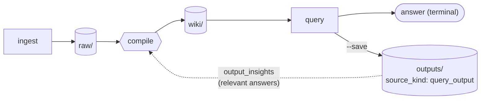

# The compounding loop

Karpathy's LLM wiki pattern depends on one detail: **query outputs are fed back into future compile runs as additional context**. Over time the wiki becomes richer in the areas that are queried, rather than only in the areas that the raw sources happened to cover.

## How it works

1. **`a2kb query "..."`** performs retrieval and LLM synthesis, prints the answer and, by default, saves it to `outputs/<timestamp>-<slug>-<id>.md` (`<id>` is 8 random hex characters, so captures within the same second never collide).
2. **`a2kb compile`** scans the most recent 15 entries in `outputs/`. For each raw file being compiled, it selects the outputs whose questions overlap topically with the raw content.
3. The selected outputs are appended to the compile prompt under a section labelled **"Prior Insights from Knowledge Base Queries (DERIVED CONTEXT)"**. The prompt instructs the LLM as follows:
   - The trust level is **derived**; the content is not a primary source.
   - Use it only as a suggestion for cross-references or angles.
   - If a derived insight conflicts with the raw source, the raw source takes precedence.
   - Do not cite the insight as evidence.

This labelling is essential. Without it, the LLM treats a prior answer as additional raw text and begins to cite its own earlier errors, which degrades the wiki over successive compiles.

## Reproducibility invariant

The text printed on the terminal must equal the text stored in `outputs/`. The save path applies no post-processing of its own (see `save_output` in `agent2kb/query.py`). The compounding loop is useful only if `outputs/` is an accurate audit trail of what was returned.

## `--save` and `--no-save`

| Use `--save` (the default for a user) when | Use `--no-save` when |
|---|---|
| The answer should inform future compiles. | The query is exploratory and aims to locate a single fact rather than build a line of enquiry. |
| The question reflects an ongoing line of work. | The question is so specific that it is unlikely to recur. |
| The answer is correct and complete. | The answer is wrong or incomplete and would mislead later compiles. |

For a sensitive project in which answers generated through a cloud LLM should not feed back into future compile prompts, `--no-save` is the appropriate default. Alternatively, set `llm.provider: ollama`.

## Promoting from a local file

`a2kb promote` operates on a **local Markdown file**, not on an existing `outputs/` entry. It is the upload path for material that should enter the KB without running ingest and compile, such as notes written by an agent, hand-edited reference sheets or manually written summaries.

| Form | Storage | Typical use |
|---|---|---|
| `a2kb promote --file ./notes.md` (default) | Writes `outputs/<timestamp>-<slug>-<id>.md` (`<id>`: 8 random hex characters, so two promotes in the same second never overwrite each other) | Transient material that the wiki should absorb through the next compile |
| `a2kb promote --file ./guide.md --as wiki-topic --slug <slug>` | Writes `wiki/topics/<slug>.md` with `pinned: true` | An evergreen reference page that other pages can cite |

Topic pages carry `source_kind: topic` (trust level: source). The compile prompt treats them as primary references rather than derived context, because a person has curated them.

To promote an answer that is already in `outputs/`, copy it into a local file first and then run `a2kb promote --file <that-file> --as wiki-topic`.

## Limits

- Only the **15 most recent** outputs are scanned per compile run. Older outputs influence the wiki only insofar as they were already incorporated into compiled pages.
- Relevance filtering is based on keyword overlap, not embeddings. It is inexpensive but imprecise: an output about "Redis Cluster" is not attached to a raw file about "agent frameworks" unless the words overlap.
- The compile prompt truncates the combined insight text to 3000 characters. Long outputs are shortened by truncation, not by summarisation.

## What is not part of the loop

- `wiki/` is not fed back into compile, because that would cause unbounded recursion.
- `wiki/concepts/` is generated from `wiki/`, not from `outputs/`. Concept pages are second-order syntheses, not third-order ones.
- `_meta/`, `_ops/` and `_meta/manifest.json` are operational data and never feed compiled content (compile reads only `_ops/maintenance.json`, to know which maintenance is still pending, and the ETag-keyed speed caches `_ops/compile-cache.json` and `_ops/url-index.json`).
