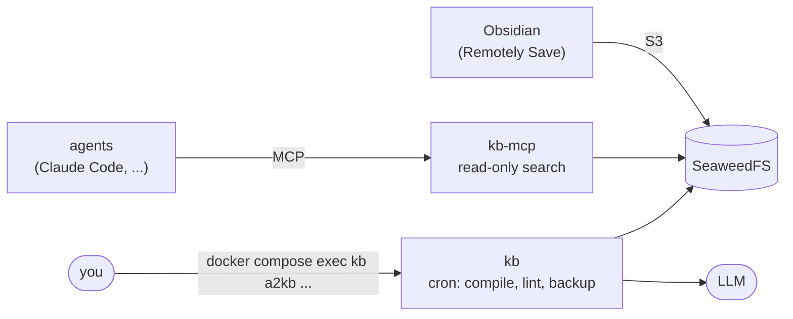

# Run the backend in 10 minutes

**TL;DR**

```bash
git clone https://github.com/jcaol/agent2kb.git && cd agent2kb
cp .env.example .env && $EDITOR .env      # at least KB_NAMES (and KB_LLM)
docker compose up -d                      # keys, bucket, KBs, cron and MCP servers are generated
docker compose exec kb claude auth login  # once, if KB_LLM=claude
docker compose exec kb a2kb connect obsidian research --show-secret   # settings for Obsidian
docker compose exec kb a2kb connect agent research --show-secret      # command for your agent
```

One `docker compose up` gives you everything agent2kb needs on a server:

- **S3 storage** (SeaweedFS) with a separate, prefix-scoped key per KB for agent2kb and for Obsidian
- **scheduled jobs**: compile, lint, backup and stubs for each KB (supercronic)
- **an MCP server** per KB over HTTP, each with its own token, for your agents
- optional **automatic HTTPS** (Caddy) for Obsidian on a phone and for remote agents

You set a small number of values in `.env`; keys, tokens, the bucket, the `a2kb` config and the crontab are
generated. Then you point Obsidian and your agents at it. The compose services are named `kb`
and `kb-mcp` ("kb" is the knowledge base here), so you run the CLI inside as
`docker compose exec kb a2kb ...`.



> **What has been verified.** The image builds, and the whole backend flow ran end to end in
> real containers (rootless podman with host networking, standing in for compose). What could
> **not** be run there, and is covered only by `scripts/docker-e2e.sh` in CI
> (`.github/workflows/docker-e2e.yml`): `docker compose up` itself and Caddy with real
> certificates. Until the CI job has passed on your fork, treat the compose wiring as new and
> report any problem you find. The full record is in [docker-testing.md](docker-testing.md).

## 1. Start it

You need a Linux server with Docker and Docker Compose v2.20 or newer (a small virtual server with
2 GB of RAM is sufficient), and a checkout of this repository:

```bash
git clone https://github.com/jcaol/agent2kb.git && cd agent2kb
cp .env.example .env
$EDITOR .env                  # at least KB_NAMES (and KB_LLM, see step 4)
docker compose up -d
```

`.env` needs only the lines you want to change. The ones that matter first:

| Variable | Default | Meaning |
|---|---|---|
| `KB_NAMES` | `research` | Your KBs, e.g. `research,work`. One KB = one Obsidian vault, one MCP server, one set of cron jobs. |
| `KB_LLM` | `claude` | Who compiles: `claude`, `codex` (log in once, step 4), `gemini`/`groq`/`openrouter` (+ `KB_LLM_API_KEY`), or `ollama` (private, on the Docker host). Cloud providers receive the content you compile: [privacy](privacy.md). |
| `KB_LANGUAGE` | `en` | Language of wiki pages and answers. |
| `KB_RECONFIGURE` | unset | `KB_LLM*` and `KB_LANGUAGE` are written into the config on the first start only; later changes are reported by `kb-provision`, not applied. Set to `1` and run `docker compose up -d` to apply them (only the `llm:` block and `output_language`; storage, KBs, keys and data are kept, the previous file is saved as `config.yaml.bak`), then remove it again. |
| `DOMAIN` | unset | Turns on HTTPS, step 6. |

The first `up` builds the image (a few minutes; about 2.2 GB with the claude and codex CLIs,
1.3 GB without them via `INSTALL_CLIS=0`, see [What the image contains](#what-the-image-contains))
and then runs, in order:

| Service | Does |
|---|---|
| `kb-init` | Generates the S3 keys and the MCP tokens (mode 0600) and splits them into one volume per consumer, see [Who can read which secret](#who-can-read-which-secret). Never replaces an existing key. |
| `seaweedfs` | S3 storage, started with those identities. |
| `kb-provision` | Waits for S3, creates the bucket, the `a2kb` config and every KB in `KB_NAMES` through the same code as `a2kb new`. Existing KBs are never touched. |
| `kb` | The cron jobs for every KB. |
| `kb-mcp` | One `a2kb mcp --http` per KB (ports 8765-8774), read-only. |
| `caddy` | HTTPS, only with `--profile https`. |

The compose project is named `agent2kb` and the image is `agent2kb:local`. The services, the
`kb-*` volumes and the `kb` user keep their short names ("kb" is the knowledge base here), so
a volume is called `agent2kb_kb-home` on the host.

To verify the installation:

```bash
docker compose ps                                  # kb-init and kb-provision "exited (0)", the rest up
docker compose exec kb a2kb list                     # your KBs
docker compose exec kb a2kb -p research doctor --read-only
```

Everything stays in named volumes (`kb-secrets`, `kb-s3conf`, `kb-connect`, `kb-mcpkeys`, `kb-home`, `kb-data`, `seaweed-data`, ...),
so there is no host directory to chown. The S3 port (8333) and the MCP ports (8765-8774) listen on
`127.0.0.1` of the server only, until you do step 6.

## 2. Connect Obsidian

```bash
docker compose exec kb a2kb connect obsidian research --show-secret
```

prints the exact settings for the **Remotely Save** plugin (Remote Service "S3 or compatible"):
endpoint, region, access key, secret key, bucket, path-style URLs, and the **remote prefix**
`kbs/research/`. Without `--show-secret` the secret is left out and the command says where to
read it. Each KB has its own `<kb>-obsidian` key; it can read, write and list only that KB's
prefix.

How the vault maps to the bucket: Remotely Save has no "folder" setting for S3, only a *remote
prefix* ("Change The Remote Prefix", then Confirm). With `kbs/research/` the vault root *is*
that prefix: `raw/`, `wiki/` and `outputs/` show up as folders, and what you or the Web Clipper
save under `Clippings/` is uploaded to `kbs/research/Clippings/`, where `a2kb compile` imports it.
Use a new, empty vault for the first sync (it downloads the KB). Keep "sync config folder" off
unless you want `.obsidian/` uploaded too.

Two points require attention:

- **Do not rely on "Check connectivity".** The plugin checks by listing the *whole bucket*,
  which a key limited to one KB is not allowed to do, so the check can fail even though syncing works.
  Run a sync instead. (This was checked against the plugin's source, version 0.5.25, and against
  SeaweedFS with the same calls: listing, put, get, delete and multipart inside the prefix work;
  a listing without prefix is refused.)
- **A phone cannot reach `127.0.0.1`.** `a2kb connect` warns when the endpoint is loopback-only.
  Obsidian on iOS also refuses plain `http://` in practice, so use HTTPS (step 6) for mobile.

Leave the plugin's encryption password empty for the KB: agent2kb reads the files as plain
Markdown and cannot decrypt what the plugin encrypts. The `<kb>-obsidian` key can write and
delete, as two-way sync requires; the stack has no read-only Obsidian key. Sync direction,
sync timing versus the cron compile, the folder layout and a first sync check are in the shared
guide, [obsidian.md](obsidian.md), which applies to this backend and to AWS and R2 alike.

## 3. Connect agents (MCP)

```bash
docker compose exec kb a2kb connect agent research --show-secret
```

prints `claude mcp add --transport http kb-research http://127.0.0.1:8765/mcp --header
'Authorization: Bearer <token>'`, the same as JSON for other MCP clients, and a stdio
alternative (`docker compose exec -T kb a2kb -p research mcp`) for agents on the Docker host that
should not use a port at all. The token is per KB and read-only by default: it gives `search`,
`read_page` and `list_recent` on that KB and nothing else. Opt in to more in `.env`
(`KB_MCP_ALLOW_WRITE`, `KB_MCP_INGEST_DOMAINS`, `KB_MCP_ALLOW_LLM`) after reading
[mcp.md](mcp.md); `ingest_url` fetches whatever URL an agent names, so list the sites it may
fetch.

`KB_MCP_KBS` (default: all of `KB_NAMES`) chooses which KBs get a server. Each gets the next free
port from 8765, remembered in `keys.json`, so adding a KB later does not move the others.

## 4. Log in to the claude or codex CLI

With `KB_LLM=claude` or `codex` the compile step reuses the login of that CLI instead of an API
key. Log in once; the `kb-home` volume keeps it across restarts and rebuilds:

```bash
docker compose exec kb claude auth login          # prints a URL; paste the code back
docker compose exec kb codex login --device-auth  # device code: no browser in the container
```

`docker compose ps` shows the `kb` service as `unhealthy` until the login works (its health
check is a read-only `a2kb doctor`). For Claude there is also `claude setup-token`, a long-lived
token for headless hosts; put it in the `kb` service environment as `CLAUDE_CODE_OAUTH_TOKEN`
with a `docker-compose.override.yml`. (The login commands exist in the current CLIs; the token
variable and the persistence in the volume have not been exercised in this image.)

Everything the CLI providers send is sandboxed by `agent2kb/cli_runner.py` (no tools, no MCP, an
empty working directory). The content you compile still goes to the vendor behind that login.
With API providers, `KB_LLM_API_KEY` ends up in the `a2kb` config inside the `kb-home` volume (and
stays in your `.env`).

## 5. Try it out

```bash
docker compose cp examples/first-note.md kb:/data/first-note.md   # a small sample from the repo
docker compose exec kb a2kb -p research ingest --file /data/first-note.md
docker compose exec kb a2kb -p research compile          # or wait: cron compiles every 15 minutes
docker compose exec kb a2kb -p research query "What is the codename of the alpha project?"
```

The expected output of each step (raw file name, wiki page, cited answer "Lantern") is
described in [first-run.md](first-run.md); there the KB is called `notes` instead of
`research`. To ingest a web page: `ingest --url <url>`.

Job output goes to log files per KB, not to `docker compose logs`:
`docker compose exec kb tail -f /data/research/kb-compile.log`.

## 6. HTTPS for phones and remote agents (optional)

Without a domain, S3 and MCP are plain HTTP on the server's loopback address. For Obsidian on a
phone, or agents on other machines, give the server a name:

1. DNS records for `s3.<DOMAIN>` and `mcp.<DOMAIN>` pointing at the server.
2. In `.env`: `DOMAIN=kb.example.com` (and `ACME_EMAIL=you@example.com` for certificate notices).
3. `docker compose --profile https up -d` (or put `COMPOSE_PROFILES=https` in `.env`).

Ports 80 and 443 must be reachable; Caddy obtains and renews the certificates by itself.
`s3.<DOMAIN>` goes to SeaweedFS and `mcp.<DOMAIN>/<kb>/mcp` to that KB's MCP server. Run the two
`a2kb connect` commands again: they now print the HTTPS addresses. (Caddy's configuration is
generated and its syntax is checked by `scripts/docker-e2e.sh`; issuing real certificates needs
your DNS and has not been exercised.)

Without a domain, `KB_BIND=0.0.0.0` publishes the ports on every interface in **plain HTTP**: the
keys and your notes would cross the network unencrypted. Only do that on a private network
(WireGuard, Tailscale); set `KB_PUBLIC_HOST` to the name clients use so `a2kb connect` prints it.
Behind your own reverse proxy use `KB_PUBLIC_S3_URL` / `KB_PUBLIC_MCP_URL` instead.

## Day to day

**Add a KB.** Add the name to `KB_NAMES` in `.env` and run `docker compose up -d`. The new keys
are written first, SeaweedFS is recreated to load them (see
[SeaweedFS and new identities](#seaweedfs-and-new-identities)), the KB is created, and the
`kb` and `kb-mcp` containers pick it up. Existing KBs, keys and data are untouched. Removing a
name deletes nothing and revokes nothing (see [Rotating or revoking keys](#rotating-or-revoking-keys)).

**Custom schedules.** The crontab is generated at start from the KBs in the config (compile every
15 minutes, lint daily, backup twice daily, stubs daily; `KB_CRON_DIGEST=1` adds the weekly
digest). To use your own, copy `docker/crontab.example` to `./crontab`, edit it and mount it in a
`docker-compose.override.yml`:

```yaml
services:
  kb:
    volumes:
      - ./crontab:/etc/kb/crontab:ro
```

Validate it with `docker compose run --rm -v ./crontab:/etc/kb/crontab:ro kb /usr/local/bin/supercronic -test
/etc/kb/crontab`; reload without a restart with `docker compose kill -s USR2 kb`. The KB config
decides which model runs; crontabs never name one.

**One-off commands.**

```bash
docker compose exec kb a2kb -p research ingest --file /data/report.pdf
docker compose exec kb a2kb -p research backup --dir /data/research/.backups
docker compose exec kb a2kb -p research lint
```

**Upgrade.** `git pull && docker compose up -d --build`. Volumes, keys and config are kept.

**Back up.** Three volumes matter: `seaweed-data` (your KBs), `kb-secrets` (the master keys;
`kb-s3conf`, `kb-connect` and `kb-mcpkeys` are re-derived from it by `kb-init`) and `kb-home` (the
`a2kb` config and CLI logins); the `kb-data` volume also holds the local `a2kb backup`
archives. Back them up together (`docker run --rm -v agent2kb_kb-secrets:/v -v "$PWD":/b alpine
tar czf /b/kb-secrets.tgz -C /v .`; the volume name is prefixed with the project name,
`docker volume ls`). Restoring the data without the secrets leaves the KBs' keys unknown to the
config.

**Health.** `kb` runs `a2kb bootstrap health` (a read-only `a2kb doctor`) every 10 minutes; `kb-mcp` checks that every server
answers; `seaweedfs` checks the S3 port.

## Changing settings after the first start

`.env` holds two kinds of settings. Most are read on every `docker compose up -d`. A few only
seed the `a2kb` config the first time it is created (by `kb-provision`, in the `kb-home`
volume at `/home/kb/.kb/config.yaml`); after that, **the stored config wins** and later edits
of those lines in `.env` are not applied. Provisioning deliberately does not rewrite an
existing config on its own, so a typo in `.env` cannot change a running installation behind
your back.

For the LLM and the language there is an opt-in switch: `KB_RECONFIGURE=1` in `.env`, then
`docker compose up -d`, applies `KB_LLM`, `KB_LLM_MODEL`, `KB_LLM_API_KEY`,
`KB_LLM_OLLAMA_HOST` and `KB_LANGUAGE` to the stored config (its exact scope is described with
the variable in the table in [step 1](#1-start-it) and in `.env.example`); remove the line
again afterwards. Everything else in the stored config (storage, per-KB settings, the
`KB_EXT_S3_*` values) is changed by editing the file, as below.

| Kind | Variables | How a change takes effect |
|---|---|---|
| **Initialisation only** (stored in the config when it is created) | `KB_LLM`, `KB_LLM_MODEL`, `KB_LLM_API_KEY`, `KB_LLM_OLLAMA_HOST`, `KB_LANGUAGE`; with external storage `KB_EXT_S3_ENDPOINT`, `KB_EXT_S3_REGION`, `KB_EXT_S3_BUCKET`, `KB_EXT_S3_ACCESS_KEY`, `KB_EXT_S3_SECRET_KEY`, `KB_EXT_S3_PRESET`; `KB_S3_INTERNAL_ENDPOINT` (stored when a KB is created) | LLM and language: `KB_RECONFIGURE=1` (above) or edit the stored config; the others: edit the stored config, below. |
| **Fixed after the first start** | `KB_BUCKET_NAME` (refused once keys exist), `KB_S3_MODE` | Not supported as a change; a new deployment is the clean route. |
| **Applied at every `up -d`** | `KB_NAMES` (adds KBs; removing one deletes nothing), `KB_MCP_KBS`, `KB_MCP_ALLOW_WRITE`, `KB_MCP_INGEST_DOMAINS`, `KB_MCP_ALLOW_LLM`, `KB_CRON_DIGEST`, `TZ`, `DOMAIN`, `ACME_EMAIL`, `COMPOSE_PROFILES`, `KB_BIND`, `KB_PUBLIC_HOST`, `KB_PUBLIC_S3_URL`, `KB_PUBLIC_MCP_URL`, `KB_S3_PORT`, `KB_EXT_S3_CREATE_BUCKET` | `docker compose up -d` (compose recreates the services whose settings changed). |
| **Image build** | `KB_EXTRAS`, `INSTALL_CLIS` | `docker compose up -d --build` |

**See what is in effect** before and after a change (secrets are masked):

```bash
docker compose exec kb a2kb -p research config show
```

### Editing the stored config

Nothing below deletes a volume or touches the KBs' data; deleting volumes is never needed to
change these settings. The image has no text editor, so copy the file out, edit it, and copy it
back:

```bash
# 1. Keep a copy inside the volume (mode and owner preserved)
docker compose exec kb cp -p /home/kb/.kb/config.yaml /home/kb/.kb/config.yaml.manual-bak
# 2. Copy it out. It contains secrets: keep it private and delete it afterwards
(umask 077 && docker compose exec -T kb cat /home/kb/.kb/config.yaml > kb-config.yaml)
# 3. Edit kb-config.yaml (see the examples below)
# 4. Copy it back, as the container's own user, with mode 0600
docker compose exec -T kb sh -c 'umask 077 && cat > /home/kb/.kb/config.yaml' < kb-config.yaml
# 5. Check, then remove the local copy
docker compose exec kb a2kb -p research config show
docker compose exec kb a2kb -p research doctor --read-only
rm kb-config.yaml
```

If the check fails, put the previous file back with
`docker compose exec kb cp -p /home/kb/.kb/config.yaml.manual-bak /home/kb/.kb/config.yaml`.

**Which services need a restart.** The cron jobs in `kb` start a new `a2kb` process for every
run and read the config each time: no restart is needed. `kb-mcp` reads the config only at
start: run `docker compose restart kb-mcp`. Mirror the change in `.env` as well, so that `.env`
describes the installation and a future fresh deployment starts with the same values.

What to edit (the full list of keys is in [configuration](configuration.md#the-config-file-v2)):

| Change | In the stored config |
|---|---|
| Add or replace an API key (for example after a first start without `KB_LLM_API_KEY`) | `llm:` → `gemini_api_key`, `groq_api_key` or `openrouter_api_key` |
| Switch the LLM, for example from `claude` to `gemini` | `llm:` → `provider: gemini`, `gemini_api_key: ...`, and `model: <a Gemini model>`. For API providers and Ollama set `model` explicitly: without it the setting falls back to a Groq model name. Keys of the old provider can stay. |
| Switch to `claude` or `codex` | `llm:` → `provider: cli`, `command: claude` (or `codex`); then log in: `docker compose exec kb claude auth login` |
| Another model | `llm:` → `model` (compile) and, optionally, `aux_model` |
| Ollama address | `llm:` → `ollama_host` |
| Output language | `defaults:` → `output_language` (all KBs), or `output_language` inside one KB's entry |
| External S3 endpoint, bucket or key | `storage:` → `endpoint`, `bucket`, `access_key`, `secret_key`; or the same inside one KB's `storage:` block |
| `KB_S3_INTERNAL_ENDPOINT` after the first start | `storage:` → `endpoint` |

A changed language applies to pages compiled from then on; existing pages keep their language
until they are recompiled (`a2kb -p research compile --force` recompiles everything and spends
LLM tokens accordingly).

## Use your own S3

Instead of the bundled SeaweedFS (Cloudflare R2, Backblaze B2, AWS, MinIO, ...): in `.env` set

```
KB_S3_MODE=external
KB_EXT_S3_ENDPOINT=https://<account-id>.r2.cloudflarestorage.com   # leave out for AWS
KB_EXT_S3_REGION=auto
KB_EXT_S3_BUCKET=my-kb-bucket
KB_EXT_S3_ACCESS_KEY=...
KB_EXT_S3_SECRET_KEY=...
KB_EXT_S3_PRESET=r2          # aws, r2, b2, minio, wasabi or other
COMPOSE_FILE=docker-compose.yml:docker-compose.external-s3.yml
```

The second compose file keeps SeaweedFS from starting. The bucket must exist (or set
`KB_EXT_S3_CREATE_BUCKET=1`). All KBs then share the one key you give: per-KB keys are a
SeaweedFS feature of this setup, so create restricted keys at your provider if you need them
([storage providers](storage-providers.md)). `a2kb connect obsidian` prints that key and reminds
you to make a separate one for Obsidian. Not exercised end to end (the bootstrap path is tested
offline against a mock S3).

The `KB_EXT_S3_*` values are stored in the config at the first start; to change them later
see [Changing settings after the first start](#changing-settings-after-the-first-start).

### Several KBs on external storage

With `KB_S3_MODE=external`, `kb-provision` creates every KB in `KB_NAMES` in the one bucket
`KB_EXT_S3_BUCKET` and signs for all of them with the one key you gave. The per-KB keys of the
bundled setup are SeaweedFS identities that this stack generates; nothing equivalent is created
at an external provider. On a provider whose keys can be limited to a prefix (AWS, B2, MinIO,
Wasabi) you can create those keys yourself and put them into each KB's `storage:` block. On
**Cloudflare R2**, whose tokens stop at the bucket, isolation needs one bucket per KB.

To give a further KB its own bucket and key, add it to the config **before** its name reaches
`KB_NAMES` (provisioning never changes a KB that already exists in the config):

1. At the provider: create the bucket (for example `kb-work`) and a key limited to it
   ([R2 recipe](storage-providers.md#cloudflare-r2)).
2. Add the KB to the stored config as shown in
   [configuration](configuration.md#several-kbs-with-separate-buckets-r2), with its own
   `storage:` block (`bucket`, `access_key`, `secret_key`), using the copy-out and copy-in
   procedure in [Editing the stored config](#editing-the-stored-config).
3. Create its skeleton and check it:
   `docker compose exec kb a2kb -p work init`, then
   `docker compose exec kb a2kb -p work doctor --read-only`.
4. Add `work` to `KB_NAMES` (for its MCP server) and run `docker compose up -d`.
   `kb-provision` reports it as existing and leaves it alone; the crontab, generated from the
   KBs in the config, includes it once `up -d` has recreated the `kb` service (`KB_NAMES` is
   part of its settings).

A KB that `KB_NAMES` created in the shared bucket stays there: moving it means copying its
prefix to the new bucket at the provider and then changing its `storage:` block, which this
guide does not cover. When KBs must be strictly separated from each other's key holders, one
deployment per KB (or per group of KBs that may share a key) remains the simplest boundary.

## How it works

`a2kb bootstrap` (hidden from `a2kb --help`; compose runs it) holds the logic, so it is tested on
the host without Docker:

| Command | Runs in | Does |
|---|---|---|
| `a2kb bootstrap init` | `kb-init`, before SeaweedFS | `keys.json` in `/secrets`; `s3.json` in `/s3conf`, `connect.json` in `/connect`, `mcp.json` in `/mcpkeys`; MCP ports and tokens; the Caddyfile in `/proxy`. |
| `a2kb bootstrap provision [--wait N]` | `kb-provision` | Bucket, config, KBs. |
| `a2kb bootstrap crontab --out F` | `kb` start | The supercronic file. |
| `a2kb bootstrap mcp-serve` | `kb-mcp` | One supervised `a2kb mcp --http` per KB; the token goes in the environment, not on the command line. |
| `a2kb bootstrap mcp-health`, `health` | health checks | Exit 1 and print the failed checks (they show in `docker inspect` and `docker compose ps`). |

`a2kb bootstrap revoke` and `rotate` are described in [Rotating or revoking keys](#rotating-or-revoking-keys).

`KB_S3_INTERNAL_ENDPOINT` (default `http://seaweedfs:8333`) is the address the kb containers use
for S3. Set it only if SeaweedFS runs outside this compose project (for example on another host);
`kb-provision` stores it in the `a2kb` config when it creates a KB, so set it before the first `up`
(an existing KB keeps its stored endpoint: edit `config.yaml` in the `kb-home` volume).

Two advanced variables exist for running these services without compose (the tests do):
`KB_MCP_PORT_BASE` (first MCP port, default 8765) and `KB_MCP_BIND` (the address the MCP servers
listen on inside the container, default `0.0.0.0`). With compose leave both alone: the
published port range is fixed.

The identities: `admin` (creates the bucket; used only by `kb-provision`), and per KB
`<kb>-writer` (what agent2kb signs with; read, write, list, tagging) and `<kb>-obsidian` (read,
write, list), both limited to `kbs/<kb>/*`. Keys are random (20-character access keys, 40-character
secrets), written once. A damaged `keys.json` stops everything instead of being reset, and
changing `KB_BUCKET_NAME` after keys exist is refused, because the bucket name is part of each
identity.
`keys.json` is always written first and the other files are re-derived from it (each by an atomic
rename) on every `init`, so a crash between two writes never leaves SeaweedFS with a key that
`keys.json` does not know; the next `up` repairs the derived files.

### Who can read which secret

`keys.json` holds every key, including the S3 **admin** key (it creates the bucket). Only the two
bootstrap services mount that volume, and `kb-provision` mounts it read-only. Everything else
gets a derived file in its own volume with only what it needs:

| Service | Mounts | Can read |
|---|---|---|
| `kb-init` | `kb-secrets`, `kb-s3conf`, `kb-connect`, `kb-mcpkeys`, `kb-proxy` (read-write) | everything: it writes the keys, and runs `rotate` / `revoke` |
| `kb-provision` | `kb-secrets` (read-only), `kb-home` | the admin key, to create the bucket; writes the `a2kb` config |
| `seaweedfs` | `kb-s3conf` (read-only) | `s3.json`: the identities it must authenticate |
| `kb` | `kb-connect` (read-only), `kb-home` | the Obsidian keys and MCP tokens (for `a2kb connect`), and the KBs' writer keys in the `a2kb` config; **no admin key** |
| `kb-mcp` | `kb-mcpkeys` (read-only), `kb-home` (read-only) | the MCP tokens, the `a2kb` config and the `claude` / `codex` logins in `kb-home`; **no admin key, no Obsidian keys** |

The `kb` service runs LLM CLIs on web content and `kb-mcp` talks to agents over HTTP, so they
are the ones that must not hold the admin key. They still hold the per-KB writer keys (in the kb
config, which agent2kb needs to work): anything that takes over the `kb` container can read and
write the KBs, but cannot create buckets or mint keys. `kb-mcp` serves one port per KB but loads
the whole `a2kb` config, so it also holds the writer keys of KBs it does not serve.

`kb-mcp` mounts all of `kb-home`, so it can also read the `claude` / `codex` logins stored there
(in `~/.claude*` and `~/.codex`). It needs them only when `KB_MCP_ALLOW_LLM` is on and the KB
uses `provider: cli` (the `ask` tool runs that CLI); a read-only server needs only `~/.kb`. The
default mount is unchanged so that existing deployments and `ask` keep working. If you do not
use `ask` with a CLI provider, you can limit `kb-mcp` to the config with a
`docker-compose.override.yml` (it needs a Compose and Docker Engine that support volume
`subpath` and the `!override` tag; the file below is checked with `docker compose config`, not
run in this image):

```yaml
services:
  kb-mcp:
    volumes: !override
      - type: volume
        source: kb-home
        target: /home/kb/.kb
        read_only: true
        volume:
          subpath: .kb
      - kb-mcpkeys:/mcpkeys:ro
```

Nothing moves: the config stays in `kb-home`, and removing the override restores the old mount.

### SeaweedFS and new identities

Checked on a throwaway SeaweedFS 4.18; the restart-to-load behaviour was exercised again on the
pinned 4.48 (every add, rotate and revoke in this guide was applied that way):

- `-s3.config=<file>` is read **once, at start**. Editing the file while the server runs changes
  nothing: the new key is answered with `InvalidAccessKeyId`.
- Identities *can* be added without a restart through `weed shell` (`s3.configure ... -apply`):
  the running server picks them up, they are stored in the filer, and they are merged with the
  file's identities after the next restart. This setup does not use it: it would keep the
  identities in two places, so `s3.json` stays the single source of truth.
- Instead, `docker-compose.yml` passes `KB_NAMES` into the `seaweedfs` service (it ignores the
  variable). Editing `KB_NAMES` therefore makes `docker compose up -d` recreate that container
  after `kb-init` has written the new identities. The data is in a volume; the restart takes about
  15 seconds, during which S3 is unavailable. If SeaweedFS is ever left running with stale
  identities, `kb-provision` stops with `docker compose restart seaweedfs` as the instruction
  instead of failing with an unclear error.

## Rotating or revoking keys

Every KB has an Obsidian key and a writer key (what agent2kb uses), plus an MCP token. They never
expire and are never replaced by `docker compose up`, so replacing one is an explicit step. Run
these with the `kb-init` service, which is the one that can write the secrets volume:

```bash
docker compose run --rm kb-init a2kb bootstrap rotate research --role obsidian   # new key; the old key is invalidated
docker compose run --rm kb-init a2kb bootstrap revoke research --role obsidian   # disable, issue none
docker compose restart seaweedfs                                               # applies it (about 15 s)
# after a writer rotation also: docker compose run --rm kb-provision && docker compose restart kb-mcp
```

- `rotate <kb> [--role writer|obsidian|mcp]` writes a fresh random key (no `--role`: writer and
  obsidian). The old key stops working when SeaweedFS has restarted, because it reads its
  identities only at start ([above](#seaweedfs-and-new-identities)). A revoked key is replaced the
  same way.
- `revoke <kb> [--role writer|obsidian]` marks the key as revoked in `keys.json` (its secret is
  deleted, the marker stays as a record) and leaves it out of `s3.json`. A revoked key is never
  issued again by itself: `init` only reminds you with the `rotate` command.
- A **writer** rotation touches three services; `rotate` prints the exact commands, in order:
  1. `docker compose restart seaweedfs` (the old key stops working),
  2. `docker compose run --rm kb-provision` (stores the new key in the `a2kb` config; the cron jobs
     use it from their next run),
  3. `docker compose restart kb-mcp`: it reads the `a2kb` config only at start and keeps answering
     `bad_credentials` until restarted (observed during testing).

  A listed KB cannot have its writer key revoked (agent2kb would lose access); rotate it instead.
- An **MCP token** rotation needs `docker compose restart kb-mcp`, then `a2kb connect agent <kb>
  --show-secret` for the new `claude mcp add` command.
- `a2kb connect obsidian <kb> --show-secret` always shows the current key; for a revoked one it
  says to rotate.

**A device holding the Obsidian key is lost.** Rotate that KB's Obsidian key (the command above),
restart SeaweedFS, then enter the new key from `a2kb connect obsidian <kb> --show-secret` on your
remaining devices. Until the restart the lost key still works. The key could read and write only
`kbs/<kb>/`, but the vault itself holds the whole KB's notes in plain files on the phone, so also
change anything sensitive in the notes. If you also saved an MCP token on that device, rotate it.

**Removing a KB from `KB_NAMES` does not revoke anything**, so its data stays reachable and its
keys keep working. Every `up` prints a warning that lists such KBs, with the revoke command. When
the KB has been permanently retired: `docker compose run --rm kb-init a2kb bootstrap revoke <kb>` and restart
SeaweedFS. Listing a fully revoked KB again in `KB_NAMES` issues fresh keys for it (the data is
still under its prefix).

## Security notes

- **SeaweedFS must be 4.34 or newer: older versions are affected by CVE-2026-55874.** The S3
  gateway did not authorise the source of a server-side copy, so a per-KB key could copy objects
  from another KB (or another bucket) into its own prefix and read them. Tested here with the
  same requests on both versions (a key limited to `kbs/research/`; other KB `kbs/work/`; a
  second bucket):

  | Request | 4.18 | 4.48 (pinned) |
  |---|---|---|
  | `CopyObject` from another KB | copied and readable | `AccessDenied` |
  | the same with `..` in the source (`kbs/research/../work/...`) | copied and readable | `InvalidArgument` |
  | `CopyObject` from another bucket | copied and readable | `AccessDenied` |
  | the same with `..` (`../secret-bucket/...`, `kbs/research/../../../secret-bucket/...`) | copied and readable | `InvalidArgument` |
  | `..` URL-encoded (`%2e%2e`) | `InvalidArgument` | `NoSuchKey` (not resolved) |
  | `UploadPartCopy` from another KB | accepted | `AccessDenied` (also from another bucket) |

  On 4.48 this held for both the writer and the Obsidian key of the stack. The bundled stack pins
  4.48 by digest; if you run your own SeaweedFS (or an older image), upgrade first. Neither agent2kb
  nor Remotely Save issues `CopyObject` (checked in agent2kb and in the plugin's `fsS3.ts`), so a
  proxy rule that rejects requests with an `x-amz-copy-source` header would cost nothing if you
  want a second layer; the stack does not add one. Scoped keys remain one layer, not the only
  one: only the cases above were tried, so if KBs must be strictly isolated from each other's key
  holders use one deployment (or bucket) per KB, and do not hand a writer key to anything you do
  not trust.
- **Prefix-scoped keys cannot call `HeadBucket` or list the bucket** (`a2kb doctor` shows a
  warning for that and then checks the prefix). On 4.48 a batch `DeleteObjects` works inside the
  prefix and answers `AccessDenied` per object outside it; agent2kb and Remotely Save use single
  deletes anyway.
- **Secrets** live in the volumes of [Who can read which secret](#who-can-read-which-secret)
  (mode 0600, owned by the `kb` user) and in the `a2kb` config in `kb-home`. The admin key is in
  `kb-secrets` and in the SeaweedFS identities only. They are not in the image, the compose file
  or the repository. `.env` holds only what you put there (an API key, if you use one): keep it
  private.
- **Plain HTTP** is the default, on loopback. Anything beyond loopback needs HTTPS or a private
  network (step 6).
- The containers run as a non-root user (uid 1000); SeaweedFS drops to its own uid 1000 too, so
  it can read the 0600 `s3.json` (checked in the 4.48 image).

## What the image contains

- Python 3.12 with `agent2kb` installed as `pip install ".[all]"` (all provider SDKs, document and
  video ingest, the MCP server; **not** local transcription)
- `ffmpeg` and `pandoc`
- the `claude` and `codex` CLIs, for `KB_LLM=claude|codex` (skip with `INSTALL_CLIS=0`)
- supercronic, pinned and checksum-verified; a non-root user `kb` (uid 1000)

Size on disk (as reported by buildah, uncompressed; Docker shows about the same): **2.2 GB** with
the defaults (`KB_EXTRAS=all`, both CLIs), **1.3 GB** with `INSTALL_CLIS=0` (API or Ollama
setups), **0.9 GB** with `INSTALL_CLIS=0` and `KB_EXTRAS=media,mcp`. Most of the full image is the
two CLIs and the Node runtime they need; the pulled SeaweedFS image adds about 0.2 GB.

Build options go in `.env`: `KB_EXTRAS` (`all`; `media,mcp` makes a smaller image; `all,whisper`
adds local transcription, about 350 MB more) and `INSTALL_CLIS` (`1`; `0` for API or Ollama
setups). Base images are pinned by digest.
