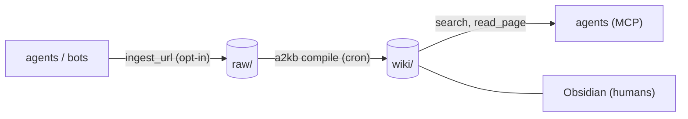

# MCP server: native agent access to a KB

`a2kb mcp` serves one knowledge base over the [Model Context Protocol](https://modelcontextprotocol.io), so an agent can search and read the wiki as tool calls instead of shelling out to `a2kb query`. By default it is read-only and spends no LLM tokens; the tools that do are opt-in.



## Quick start

```bash
pip install '.[mcp]'                                    # from a checkout; already in '.[all]'
a2kb -p myproject init                                  # create the KB structure
a2kb -p myproject ingest --url https://example.com/post # put something in raw/
a2kb -p myproject compile                               # raw/ -> wiki/ (this is what makes search useful)
claude mcp add kb -- a2kb -p myproject mcp              # register with Claude Code
claude mcp list                                       # kb should show as connected
```

`search` only sees compiled wiki pages, so it returns nothing until the first `a2kb compile` has run (`kb_info` shows the page counts, and `list_recent("raw")` shows what is waiting to be compiled). If `claude mcp list` cannot start the server, the usual cause is that `a2kb` is not on the `PATH` of the process that launches it: register the absolute path (`which a2kb`) instead.

## Install

The MCP SDK is an optional extra, so a plain `agent2kb` install stays small. Until the first
PyPI release, install from a checkout:

```bash
pip install '.[mcp]'             # pulls mcp>=1.30 (not 2.0 or 2.1), <3; included in '.[all]'
```

Without it, `a2kb mcp` prints this hint and exits with status 1.

**SDK versions.** Supported range: `mcp>=1.30,!=2.0.*,!=2.1.*,<3`, the same bound as in `pyproject.toml`; older releases, 2.0 and 2.1 have published vulnerabilities fixed in 1.30 and 2.2. The code works with both the 1.x (`FastMCP`) and the 2.x (`MCPServer`) API. The test suite is developed against mcp 2.3; three tests that need 2.x's in-process `Client` are skipped on 1.x. On mcp 1.30 the tool registration, the HTTP guard and a real stdio round trip were checked by hand, not by the automated suite.

## Register it with an agent

The KB is resolved the normal way: `-p/--profile`, `$KB_PROFILE`, or the nearest `.kb/config.yaml`. Always pin it in the registration so the agent cannot end up on a different KB.

### Claude Code

```bash
claude mcp add kb -- a2kb -p myproject mcp
# with the opt-in tools:
claude mcp add kb -- a2kb -p myproject mcp --allow-llm --allow-write
```

### Codex

`~/.codex/config.toml` (this snippet has not been tried against a real Codex install; check it against the Codex MCP docs):

```toml
[mcp_servers.kb]
command = "a2kb"
args = ["-p", "myproject", "mcp"]
```

### Claude Desktop

`claude_desktop_config.json`. Use the absolute path to `a2kb` (`which a2kb`): desktop apps often do not inherit your shell `PATH`, and the same applies to any client that launches `a2kb` itself. This stdio entry is the way to use Claude Desktop; it has not been tested against every Desktop version.

```json
{
  "mcpServers": {
    "kb-myproject": {
      "command": "/home/you/.local/bin/a2kb",
      "args": ["-p", "myproject", "mcp"]
    }
  }
}
```

### Docker backend

If you run the [Docker backend](docker.md), every KB already has an HTTP server with its own
token. `docker compose exec kb a2kb connect agent <kb> --show-secret` prints the exact
`claude mcp add --transport http ...` command (URL and token), and a stdio alternative. Outside Docker the same
command prints the stdio registration and the recipe for `--http`.

## Tools

| Tool | Flag needed | What it does |
|---|---|---|
| `kb_info` | none | KB name, output language, counts of wiki pages, raw files (of any type) and outputs pages, last wiki update, enabled capabilities. |
| `search(query, limit=10)` | none | Ranked hits: title, wiki path, snippet, score. Retrieval only, no LLM answer. Cross-language expansion uses the built-in dictionary, never the LLM. If you ran `a2kb embed` or configured a reranker, the KB's embedding/rerank provider is used as in `a2kb query`. |
| `read_page(path)` | none | One `.md` page under `wiki/`, `raw/` or `outputs/`, e.g. `wiki/redis-cluster.md`. |
| `list_recent(kind="wiki", limit=20)` | none | Most recently modified pages in `wiki`, `raw` or `outputs`. `raw` also lists non-Markdown files (PDFs, images); `read_page` reads `.md` only. |
| `ask(question, save=false)` | `--allow-llm` | Full LLM answer with citations (same engine as `a2kb query`). **Costs tokens** and sends retrieved excerpts to the KB's LLM provider; the server logs a warning on stderr for non-Ollama providers. `save=true` stores it in `outputs/agent/` exactly like `a2kb query --actor agent --save`. |
| `ingest_url(url, tags=None)` | `--allow-write` | Adds a URL to `raw/` through the normal pipeline: private-address block, pre-ingest safety check (a flagged URL is refused, never prompted), duplicate detection (returns the existing raw page). A URL naming a file (`.md`, `.txt`, `.pdf`, `.docx`, `.xlsx`, `.rtf`) is downloaded through the same guard and converted like a local file; other file types (for example audio, `.odt` and `.epub`) are refused with an error. Never compiles; the cron `a2kb compile` turns it into a wiki page. **Also makes one LLM call** to extract entities (up to 4000 characters of the page go to the KB's compile provider), unless `privacy_mode` is on and that provider is not local (Ollama); see [privacy](privacy.md). |

Results are Markdown text, capped at 40 KB with a visible truncation note. Paths in results and arguments are always relative to the KB (`wiki/...`), never the S3 prefix.

With no flags the server is read-only and free to call.

## Flags

```
a2kb -p <kb> mcp [--allow-llm] [--allow-write [--ingest-allow-domain DOMAIN]...]
                    [--http HOST:PORT [--token TOKEN | --no-auth]
                     [--allow-origin ORIGIN]... [--allow-host HOST]...]
```

| Flag | Meaning |
|---|---|
| `--allow-llm` | Register `ask`. |
| `--allow-write` | Register `ingest_url`. |
| `--ingest-allow-domain DOMAIN` | With `--allow-write`: only ingest URLs on this domain or its subdomains (repeatable; enforced on every redirect hop). Recommended whenever the server is reachable over HTTP; see [Fetch safety](#fetch-safety-ssrf). |
| `--http HOST:PORT` | Serve streamable HTTP at `http://HOST:PORT/mcp` instead of stdio. |
| `--token TOKEN` | Bearer token for HTTP (min 16 characters). Prefer `KB_MCP_TOKEN` in the environment: arguments show up in `ps`. Required for non-loopback binds; generated for you on loopback if omitted. |
| `--no-auth` | Loopback only: serve HTTP with no bearer token. See the risk described below. |
| `--allow-origin ORIGIN` | Accept requests from this browser `Origin` (repeatable). Default: none. |
| `--allow-host HOST` | Accept this extra `Host` header value (repeatable), e.g. a reverse proxy's public name. |

stdio is the default and what local agents want: the agent launches the server as a child process and nothing listens on the network. `--token`, `--no-auth`, `--allow-origin` and `--allow-host` are an error without `--http`; a stray `KB_MCP_TOKEN` in the environment is ignored in stdio mode.

### HTTP mode

```bash
# loopback: a random token is generated and printed once on stderr,
# together with ready-to-paste client config
a2kb -p myproject mcp --http 127.0.0.1:8765

# fixed token (needed for anything that is not loopback, or the server refuses to start)
export KB_MCP_TOKEN="$(openssl rand -hex 24)"
a2kb -p myproject mcp --http 0.0.0.0:8765 --allow-host kb.example.com
```

Three checks run on every request, in both token and `--no-auth` modes:

1. **`Host`** must be the bound `host:port` or `localhost`/`127.0.0.1`/`[::1]` on that port, plus any `--allow-host` values; otherwise `421`. This stops DNS rebinding.
2. **`Origin`**: browsers always send it, agents and CLIs do not. A request that has an `Origin` header is refused with `403` unless that origin was given with `--allow-origin`.
3. **`Authorization: Bearer <token>`** is compared in constant time; otherwise `401`.

The server speaks plain HTTP: put it behind a TLS reverse proxy (or a private network such as WireGuard/Tailscale) before exposing it beyond a trusted LAN, and pass the proxy's public name with `--allow-host`.

The JSON below is the generic remote-server form (`url` plus `headers`) used by clients that support streamable HTTP with custom headers, such as Claude Code's `.mcp.json`. Claude Desktop's config file may not accept `url`/`headers`; use the stdio entry above for Desktop.

```json
{
  "mcpServers": {
    "kb-myproject": {
      "type": "http",
      "url": "http://127.0.0.1:8765/mcp",
      "headers": { "Authorization": "Bearer <token>" }
    }
  }
}
```

Claude Code: `claude mcp add --transport http kb http://127.0.0.1:8765/mcp --header 'Authorization: Bearer <token>'`.

#### Why loopback still gets a token

A server on `127.0.0.1` is not private from your own browser. Any web page you open can make requests to `http://127.0.0.1:<port>`, and with DNS rebinding it can even look same-origin. Host/Origin checks stop the common routes, but the token is what holds if one is missed; the MCP specification asks local HTTP servers for both.

`--no-auth` removes that last layer. Any local process (other users on a shared machine, a compromised dependency) and any page that gets past the Host/Origin checks can then search and read this KB, and use `ask`/`ingest_url` if you enabled them. Use it only on a single-user machine, for a read-only server, and prefer stdio where the agent can launch the process itself. It is refused for non-loopback binds.

## Security model

- **Scope is one KB.** All storage access goes through the same prefix-enforced S3 client as the rest of agent2kb. A member KB cannot read another KB, and the agent cannot name a bucket or key directly.
- **Readable paths are an allow-list:** `<wiki|raw|outputs>/.../*.md` relative to the KB. Absolute paths, `..`, backslashes, hidden segments (such as the `raw/.failed/` quarantine) and non-`.md` files are rejected.
- **`_meta/` is never reachable through MCP**, even when the server runs on an admin KB (`role: admin`). Prefer member KBs for agents anyway.
- **HTTP is guarded three ways** (Host check, Origin refusal, bearer token), also on loopback; see [HTTP mode](#http-mode).
- **Content is untrusted.** Wiki and raw pages are compiled from web pages, videos and other people's documents. Tool descriptions say so, and your agent should treat page text as data, not as instructions. This is why `ingest_url` and `ask` are opt-in: an injected page must not be able to induce a read-only agent to spend money or write data.
- **Fetches are guarded.** `ingest_url` blocks private/metadata addresses, re-validates every redirect and pins the connection; see [Fetch safety](#fetch-safety-ssrf).
- **Writes are narrow.** `ingest_url` only adds to `raw/`. `ask --save` only adds to (or, for a repeat question within the hour, updates) `outputs/agent/`. Nothing in this server edits or deletes existing pages.
- **No credentials or config in results.** `kb_info` reports the KB name, language and counts, not endpoints, buckets or keys. Unexpected errors return a generic message; the detail goes to the server log.
- **Logging is stderr only** (one line per tool call: name, duration, truncated arguments; never page content or answers). In stdio mode stdout carries the protocol, so nothing else may write there; stray output from ingest handlers is redirected to stderr while a tool runs.

## Fetch safety (SSRF)

`ingest_url` makes this machine fetch a URL chosen by an agent, which processes untrusted content and can therefore be manipulated into requesting arbitrary addresses. The fetch goes through `agent2kb.net_guard`, which also protects `a2kb ingest --url` and shortener expansion at compile time:

- **Fail closed.** Only `http`/`https`. A name that does not resolve, or resolves to nothing, is refused. Every resolved address must be globally routable: loopback, RFC 1918, link-local (cloud metadata `169.254.169.254`), CGNAT `100.64/10`, multicast, reserved and unspecified ranges are blocked, including IPv6 forms that wrap an IPv4 address (`::ffff:127.0.0.1`, 6to4, NAT64). Shorthand numeric hosts such as `http://2130706433/`, `http://0x7f.0.0.1/`, `http://0177.0.0.1/` or `http://127.1/` are refused before any lookup, because resolvers disagree on them (glibc reads a leading `0` as octal, macOS as decimal); only canonical dotted quads such as `93.184.216.34` are accepted. URLs with embedded credentials are refused.
- **Redirects are followed by hand.** The first URL and every `Location` hop (limit 5) are validated again, scheme and addresses included.
- **The connection is pinned.** The name is resolved once, the addresses validated, and the request connects to that exact IP. The `Host` header and the TLS SNI/certificate check still use the real name, so HTTPS works normally. A DNS answer that changes between "check" and "connect" (DNS rebinding) therefore cannot redirect the connection to an internal address.
- Response bodies are capped at 100 MB.
- If `HTTP_PROXY`/`HTTPS_PROXY` applies to a host, the proxy does the DNS lookup and the connection, so pinning is not possible: addresses are still validated before each hop, and the proxy is your egress control.

What the guard does **not** cover:

- **yt-dlp (video URLs).** agent2kb validates the URL, then yt-dlp performs its own DNS resolution and follows redirects itself, which agent2kb cannot control. So over MCP, a video URL is accepted only from YouTube, or from a domain you listed with `--ingest-allow-domain`. `a2kb ingest --url` on other video hosts keeps its old behaviour, with the stricter fail-closed check up front. yt-dlp downloads are capped at 1 GiB (`--max-filesize`, when the size is known in advance).
- **Jina Reader (`r.jina.ai`).** When enabled it fetches the page from Jina's servers, not from yours, so it cannot reach your internal network; however, Jina receives the URL (including any query string) and follows redirects on its own. Therefore: it is **never used while `--ingest-allow-domain` is active** (direct guarded fetch only, so the allow-list holds on every hop), and it is **never a fallback for a guard refusal**: if the direct fetch was blocked (private address, bad scheme or name, redirect off the allow-list), the ingest fails instead of asking Jina to fetch it. Jina is still used for ordinary failures (network errors, JS-only pages) per `allow_jina_reader`; turn it off entirely with `allow_jina_reader: false` or `privacy_mode: true`.
- **What a public page contains.** The guard decides which addresses the server connects to, not whether the content is accurate; see the untrusted-content note above.

Recommended setup for a server reachable over HTTP, or used by agents you do not fully control: `--allow-write --ingest-allow-domain` with the sites that KB is meant to follow. A URL outside the list is refused before any request is made. A listed site that redirects elsewhere is followed only until the first hop that leaves the list: that hop is refused, nothing is requested from the other domain, and Jina Reader is not asked to fetch it instead.

## One KB per server

Run one server per project and register each under its own name. The KB is the isolation boundary, so an agent connected to `kb-sales` has no tool that can reach `kb-engineering`:

```bash
claude mcp add kb-sales       -- a2kb -p sales mcp
claude mcp add kb-engineering -- a2kb -p engineering mcp --allow-write
```

For a team of agents with different privileges, give each its own registration and its own flags (for example a read-only server for most agents and `--allow-write` only for the intake bot), ideally with an S3 identity limited to that KB's prefix as a second line of defence.

## Caching and concurrent calls

A server process keeps the KB's embedding index in memory between `search` and `ask` calls
instead of reloading it on every call. Before each use it checks the index object's ETag (one
HEAD request) and reloads it when a compile or `a2kb embed` saved a new one, so results never
lag a refresh. Only one index is held; the old one is dropped on reload. Candidate pages are
fetched in parallel batches.

Tool calls can overlap. `ask(save=true)` merges a follow-up into a recent capture under a
per-process lock and with an S3 conditional write, retrying on a conflict, so overlapping saves
(also from other processes) do not overwrite each other; see
[Concurrent writers](operations.md#concurrent-writers) for the limits.
